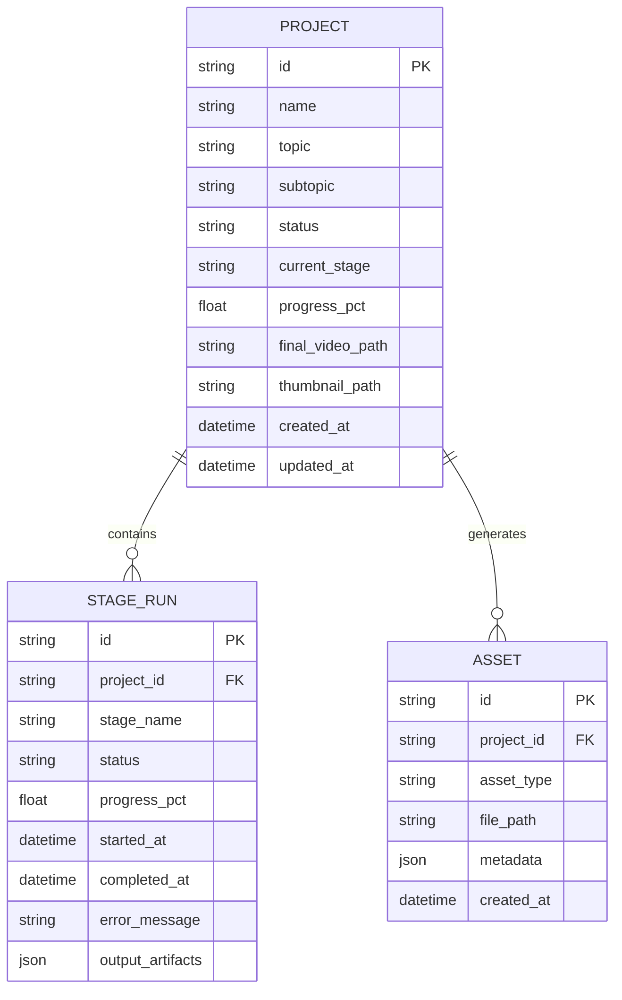

# 04. Backend Architecture (FastAPI & Celery)

The backend service (`videoforge-backend`) is built on **FastAPI** and **Celery**, delivering high-performance asynchronous orchestration, robust REST APIs, real-time WebSocket progress distribution, and persistent relational state.

---

## 🏗️ Backend Directory Structure

```
videoforge-backend/
├── app/
│   ├── api/
│   │   ├── routers/
│   │   │   ├── projects.py        # Project CRUD operations
│   │   │   ├── pipeline.py        # Pipeline start, pause, abort, inspect
│   │   │   └── assets.py          # Asset browsing and downloading
│   │   └── dependencies.py        # Database sessions & auth dependencies
│   ├── config.py                  # Pydantic Settings & environment parsing
│   ├── core/
│   │   ├── database.py            # SQLAlchemy engine, sessions, and base models
│   │   ├── events.py              # Event schemas (PipelineEvent)
│   │   └── websocket.py           # WebSocket connection manager
│   ├── models/                    # SQLAlchemy database models
│   │   ├── project.py             # Project & StageRun models
│   │   └── asset.py               # Media asset records
│   ├── schemas/                   # Pydantic request & response schemas
│   │   ├── project.py
│   │   └── pipeline.py
│   ├── services/                  # Business logic isolation
│   │   ├── project_service.py
│   │   └── pipeline_service.py
│   ├── adapters/                  # External service adapters
│   │   ├── chat_tts_adapter.py    # Edge-TTS / Local TTS adapter
│   │   └── whisper_aligner.py     # Whisper word-level timestamp aligner
│   └── utils/
│       └── files.py               # Safe path resolution and directory creation
├── bin/                           # Local bundled FFmpeg binaries
├── pipeline/                      # 9-stage orchestrator and stage definitions
│   ├── orchestrator.py            # Main PipelineOrchestrator class
│   └── stages/                    # Individual Stage implementations (1-9)
├── renderers/
│   └── diagram_renderer.py        # Dynamic SVG and HTML5 visual generator
├── generate_video_clips.py        # Standalone clip generator engine (v2)
├── generate_video.py              # Standalone educational video pipeline script
├── main.py                        # FastAPI application entrypoint
└── pyproject.toml                 # Dependencies and build configuration
```

---

## ⚙️ Configuration & Environment (`app/config.py`)

Configuration is managed via `pydantic-settings` reading from `.env`:

| Key | Default | Description |
| :--- | :--- | :--- |
| `APP_NAME` | `VideoForge` | Application identifier in OpenAPI and logs |
| `PORT` | `8000` | Port for the FastAPI HTTP & WebSocket server |
| `HOST` | `0.0.0.0` | Bind host address |
| `DATABASE_URL` | `postgresql://...` | Connection URI (defaults to Postgres, supports SQLite) |
| `REDIS_URL` | `redis://localhost:6379/0` | Broker and result backend for Celery |
| `ANTHROPIC_API_KEY` | `sk-ant-...` | API key for Claude 3.7 Sonnet / Haiku |
| `TTS_PROVIDER` | `edge` | Active TTS provider (`edge`, `elevenlabs`, `styletts2`) |
| `DEFAULT_WIDTH` | `1920` | Native video render width in pixels |
| `DEFAULT_HEIGHT` | `1080` | Native video render height in pixels |
| `DEFAULT_FPS` | `30` | Render frame rate |
| `DEFAULT_WORDS_PER_MINUTE` | `150` | Calibrated speech pace for duration calculations |

---

## 🌐 REST API Endpoints

### 1. Projects Router (`/api/v1/projects`)
* `GET /api/v1/projects`: List all video generation projects with current progress.
* `POST /api/v1/projects`: Create a new video project.
  * **Payload**:
    ```json
    {
      "name": "Operating Systems Architecture",
      "topic": "Operating Systems",
      "subtopic": "Virtual Memory and Paging",
      "user_explanation": "Explain page tables, TLBs, and page faults clearly.",
      "target_duration_minutes": 45,
      "target_audience": "intermediate",
      "visual_style": "cinematic",
      "pacing": "moderate"
    }
    ```
* `GET /api/v1/projects/{project_id}`: Retrieve project state, metadata, and stage outputs.
* `DELETE /api/v1/projects/{project_id}`: Remove project and its file artifacts.

### 2. Pipeline Router (`/api/v1/pipeline`)
* `POST /api/v1/pipeline/{project_id}/start`: Begin or resume execution through the 9 stages.
* `POST /api/v1/pipeline/{project_id}/pause`: Safely pause after current stage completion.
* `POST /api/v1/pipeline/{project_id}/abort`: Cancel active tasks and mark project status as failed.
* `GET /api/v1/pipeline/{project_id}/status`: Query instantaneous status and current stage name.
* `GET /api/v1/pipeline/{project_id}/stages`: Retrieve stage history and logs.

### 3. Static Media Mount
* `GET /projects/{project_id}/...`: Direct browser streaming for `.mp4` video files, `.html` scene previews, and `.jpg` thumbnails.

---

## ⚡ Real-Time WebSocket Hub (`/ws/{project_id}`)

To avoid inefficient HTTP polling during multi-minute video rendering jobs, VideoForge provides a dedicated WebSocket hub (`app/core/websocket.py`).

### Event Lifecycle

1. **`started`**: Emitted when pipeline execution begins.
   ```json
   {
     "type": "started",
     "project_id": "proj_123",
     "total_stages": 9,
     "timestamp": 1729314000
   }
   ```
2. **`progress`**: Emitted periodically during long-running tasks.
   ```json
   {
     "type": "progress",
     "stage_name": "assets",
     "stage_index": 5,
     "total_stages": 9,
     "message": "Generating TTS audio for Scene 3 (clip 4/8)...",
     "progress_pct": 58.4,
     "timestamp": 1729314050
   }
   ```
3. **`stage_complete`**: Emitted when a stage successfully passes its quality gate.
4. **`complete`**: Emitted with the final video URL when mastering is finished.
5. **`failed`**: Emitted if any unrecoverable error occurs, including stack trace summaries.

---

## 🗄️ Database Models (`app/models/project.py`)



---

## 🚀 Standalone Generation Scripts

In addition to running as a web service, the backend includes powerful standalone CLI engines:

### 1. `generate_video_clips.py` (Clip Engine v2)
* High-throughput batch generator focusing on rendering dynamic 1080p SVG scenes.
* Generates 8–12 cinematic visual clips per scene using `DiagramRenderer`.
* Integrates `ChatTTSAdapter` (Edge-TTS) and `WhisperAligner`.
* Run directly via:
  ```bash
  python generate_video_clips.py --project-id my-project
  ```

### 2. `generate_video.py`
* Self-contained educational generator with a pre-configured 50-minute Computer Science curriculum.
* Useful for end-to-end benchmark tests and offline pipeline verification.
